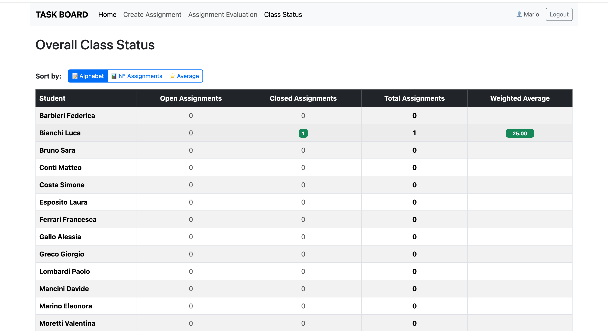
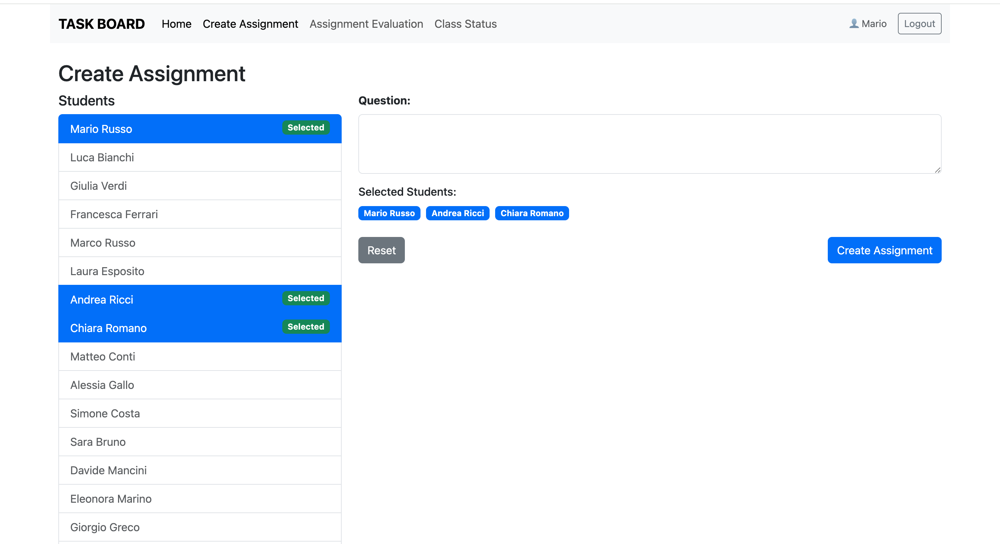

[](https://classroom.github.com/a/F9jR7G97)

# Exam #2: "Compiti"
## Student: s348967 DE BORTOLI FRANCESCA 

## React Client Application Routes

- Route `/`: Homepage pubblica dell'applicazione che mostra il form di login e permette di effetuare l'autenticazione. Dopo il login l'utente viene reindirizzato alla dashboard dedicata allo student se il suo ruolo è di studente, diversamente alla dashboard di teacher se il suo ruolo è di docente.
- Route `/student`: Dashboard dello studente autenticato, di cui mostra nome ed email, la media ponderata dei voti e l'elenco dei suoi assignments completati (chiusi) con relativo voto, domanda e risposta visibili. Permette di accedere alla pagina di Answer Form.
- Route `/student/answer-form`: Pagina accessibile solo allo studente autenticato, mostra i suoi assignments in corso (aperti) e permette di inserire/modificare una risposta ed inviarla. 
- Route `/teacher`: Dashboard del docente autenticato, di cui mostra nome ed email. Permette di accedere alle pagine di Create Assignment, Assignment Evaluation e Class Status.
- Route `/teacher/create-assignment`: Pagina accessibile solo al docente autenticato. Permette di visualizzare tutti gli studenti, creare un assignment per un gruppo di essi, selezionando da 2 a 6 studenti (nessuno di essi deve avere già collaborato con un altro studente del gruppo per più di due volte con quel docente) ed inserire una domanda. Una volta creato e confermato l'invio, lo stato dell'assignment è open.
- Route `/teacher/assignment-evaluation`: Pagina accessibile solo al docente autenticato. Permette di visualizzare tutti gli assignments che hanno ricevuto una risposta ma non sono ancora stati valutati e permette inoltre di inserire ed inviare una valutazione da 0 a 30. Una volta valutato, lo stato dell'assignment passa da open a closed. 
- Route `/teacher/class-status`: Pagina accessibile solo al docente autenticato. Permette di visualizzare una tabella con tutti gli studenti presenti nel database ma di vedere i dati solo di quelli coinvolti in assignments direttamente dal docente autenticato. I campi della tabella sono assignment aperti, assignment chiusi, assignments totali e media ponderata (pesi calcolati in base al numero di partecipanti al singolo assignment valutato). Inoltre la tabella è ordinabile alfabeticamente, per numero totale di assignment e media ponderata. 


## API Server 

#### **Login**
- **URL**:`/api/session`
- **Metodo HTTP**: POST
- **Descrizione**: consente l'autenticazione dell'utente tramite login (email e password). Se le credenziali sono valide, viene avviata una sessione e restituito l'oggetto utente.
- **Corpo della richiesta**:
```json
{
  "email": "name.surname@studenti.polito.it",
  "password": "password"
}
```
- **Risposta**: `201 Created` (successo) 
- **Corpo della risposta**:
```json
{   
  "id": 1,   
  "email": "name.surname@studenti.polito.it",
  "name": "Nome",
  "surname": "Cognome",
  "role": "student"
} 
```

#### **getUser** 
- **URL**: `/api/sessions/current` 
- **Metodo HTTP**: GET 
- **Descrizione**: Ottiene le informazioni dell'utente correntemente autenticato (che sia student o teacher)
- **Corpo della richiesta**: Nessuno
- **Risposta**: `200 OK` (successo), `401 Unauthorized` (non autenticato)
- **Corpo della risposta**:
```json
{
  "id": 1,
  "email": "name.surname@studenti.polito.it",
  "name": "Nome",
  "surname": "Cognome",
  "role": "student"
}
```

#### **Logout** 
- **URL**: `/api/sessions/current` 
- **Metodo HTTP**: DELETE 
- **Descrizione**: Termina la sessione dell'utente corrente
- **Corpo della richiesta**: Nessuno
- **Risposta**: `204 No Content` (successo)
- **Corpo della risposta**: Nessuno

#### **Get All Students**
- **URL**: `/api/students` 
- **Metodo HTTP**: GET 
- **Descrizione**: Ottiene la lista di tutti gli studenti (richiede autenticazione)
- **Corpo della richiesta**: Nessuno
- **Risposta**: `200 OK` (successo), `500 Internal Server Error`
- **Corpo della risposta**:
```json
[
  {
    "id": 1,
    "name": "Mario",
    "surname": "Rossi"
  },
  {
    "id": 2,
    "name": "Giulia",
    "surname": "Bianchi"
  }
]
```

#### **Create Assignment**
- **URL**: `/api/assignments` 
- **Metodo HTTP**: POST 
- **Descrizione**: Crea un nuovo compito (solo per insegnanti). Verifica che le coppie di studenti non abbiano già svolto più di 2 compiti insieme con lo stesso docente
- **Corpo della richiesta**: 
```json
{
  "question": "Testo della domanda del compito",
  "studentIds": [1, 2, 3, 4]
}
```
- **Risposta**: `201 Created` (successo), `400 Bad Request`, `422 Unprocessable Entity` (gruppo invalido)
- **Corpo della risposta**:
```json
{
  "id": 123
}
```

#### **Get Teacher's Assignments**
- **URL**: `/api/assignments` 
- **Metodo HTTP**: GET 
- **Descrizione**: Ottiene tutti i compiti creati dall'insegnante autenticato
- **Corpo della richiesta**: Nessuno
- **Risposta**: `200 OK` (successo), `500 Internal Server Error`
- **Corpo della risposta**:
```json
[
  {
    "id": 1,
    "teacherId": 5,
    "question": "Domanda del compito",
    "response": "Risposta degli studenti",
    "grade": null,
    "status": "open"
  }
]
```

#### **Grade Assignment**
- **URL**: `/api/assignments/:id/grade` 
- **Metodo HTTP**: PATCH 
- **Descrizione**: Assegna un voto a un compito (solo per insegnanti). Il compito deve avere una risposta e essere aperto
- **Corpo della richiesta**: 
```json
{
  "grade": 8.5
}
```
- **Risposta**: `204 No Content` (successo), `403 Forbidden` (compito non valutabile), `400 Bad Request` (voto invalido), `500 Internal Server Error`
- **Corpo della risposta**: Nessuno

#### **Get Class State**
- **URL**: `/api/students/state` 
- **Metodo HTTP**: GET 
- **Descrizione**: Ottiene lo stato della classe per il docente: compiti aperti, chiusi e media ponderata per ogni studente
- **Corpo della richiesta**: Nessuno
- **Risposta**: `200 OK` (successo), `500 Internal Server Error`
- **Corpo della risposta**:
```json
[
  {
    "studentId": 3,
    "name": "Mario",
    "surname": "Russo",
    "openCount": 2,
    "closedCount": 5,
    "averageGrade": "7.85"
  },
  {
    "studentId": 5,
    "name": "Giulia",
    "surname": "Verdi",
    "openCount": 1,
    "closedCount": 1,
    "averageGrade": "30.00"
  }
]
```

#### **Get Student's Assignments**
- **URL**: `/api/assignments/student` 
- **Metodo HTTP**: GET 
- **Descrizione**: Ottiene tutti i compiti assegnati allo studente autenticato
- **Corpo della richiesta**: Nessuno
- **Risposta**: `200 OK` (successo), `500 Internal Server Error`
- **Corpo della risposta**:
```json
[
  {
    "id": 5,
    "teacherId": 1,
    "question": "Spiega il Teorema di Pitagora",
    "grade": 28,
    "status": "closed",
    "response": "È il teorema che ...",
    "teacher": "Marco Bianchi"
  },
  {
    "id": 7,
    "teacherId": 2,
    "question": "Descrivi la fotosintesi clorofilliana",
    "grade": null,
    "status": "open",
    "response": null,
    "teacher": "Sara Verdi"
  }
]
```

#### **Submit/Update Response**
- **URL**: `/api/assignments/:id/response` 
- **Metodo HTTP**: PUT 
- **Descrizione**: Invia o aggiorna la risposta a un compito (solo per studenti). Il compito deve essere aperto
- **Corpo della richiesta**: 
```json
{
  "response": "Testo della risposta al compito"
}
```
- **Risposta**: `204 No Content` (successo), `403 Forbidden` (non studente o compito chiuso), `400 Bad Request` (dati invalidi), `500 Internal Server Error`
- **Corpo della risposta**: Nessuno

#### **Get Student's Weighted Average**
- **URL**: `/api/students/me/average` 
- **Metodo HTTP**: GET 
- **Descrizione**: Calcola la media ponderata dello studente autenticato. I voti sono ponderati in base al numero di studenti nel gruppo del compito
- **Corpo della richiesta**: Nessuno
- **Risposta**: `200 OK` (successo), `403 Forbidden` (non studente), `500 Internal Server Error`
- **Corpo della risposta**:
```json
{
  "average": "7.85"
}
```


## Database Tables

- **`users`** - Contiene le credenziali degli utenti registrati:
  - **`id`** – **Primary Key** auto-incrementale
  - **`name`** – Nome dell’utente
  - **`surname`** – Cognome dell’utente
  - **`email`** – Email per il login, **Unique**
  - **`role`** – Ruolo dell’utente (`student` o `teacher`)
  - **`password`** – Password in formato hash
  - **`salt`** – Valore salt utilizzato per hashing sicuro

- **`assignments`** - Contiene i compiti assegnati dai docenti:
  - **`id`** – **Primary Key** auto-incrementale
  - **`teacherId`** – Riferimento al docente (**Foreign Key** ->`users.id`)
  - **`question`** – Testo della domanda
  - **`status`** – Stato del compito (`open` o `closed`)
  - **`grade`** – Voto (intero tra 0 e 30)
  - **`response`** – Testo della risposta fornita dagli studenti

- **`assignment_students`** - Mappa/collega la partecipazione degli studenti ai compiti:
  - **`assignmentId`** – Riferimento al compito (**Foreign Key** ->`assignments.id`)
  - **`studentId`** – Riferimento allo studente (**Foreign Key** ->`users.id`)
  - **Primary Key** composta (`assignmentId`, `studentId`)

## Main React Components

- `LoginForm` (in `Login.jsx`): 

**Scopo del componente:**  
Permette agli utenti (studenti e docenti) di autenticarsi tramite email e password.  
**Funzionalità principali:**
- Contiene un form di login con validazione.
- Gestisce il flusso di login.

---

- `AppNavBar` (in `NavHeader.jsx`):


**Scopo del componente:**  
Definisce la barra di navigazione principale, modificando il menù in base al ruolo dell’utente.  
**Funzionalità principali:**
- Fornisce una navigazione coerente a seconda del ruolo, mostrando percorsi specifici per `teacher` e `student`.
- Visualizza nome dell’utente.
- Include pulsante Logout e titolo (TASK BOARD).

---

- `DefaultLayout` (in `DefaultLayout.jsx`):

**Scopo del componente:**  
Fornisce il layout base condiviso per tutte le pagine dell'applicazione.  
**Funzionalità principali:**
- Visualizza sempre la navbar (`AppNavbar`) nella parte superiore.
- Gestisce la logica di logout e passa l'utente loggato a tutti i figli.
- Utilizza `<Outlet />` per rendere visibile la pagina corrente nella posizione corretta.

---

- `NotFound` (in `NotFound.jsx`):

**Scopo del componente:**  
Mostra un messaggio di errore in caso di percorso non valido (pagina 404).  
**Funzionalità principali:**
- Visualizza un semplice messaggio testuale per tutte le route non definite.

---

- `AssignmentEvaluation` (in `AssignmentEvaluation.jsx`):

**Scopo del componente:**  
Permette al docente di visualizzare e valutare gli assignment con status open che hanno ricevuto una risposta.  
**Funzionalità principali:**
- Elenca tutti i compiti aperti con annessa risposta.
- Permette di assegnare un voto (tra 0 e 30) a ciascun assignment.
- Mostra messaggi di successo o errore.

---

- `ClassStatus` (in `ClassStatus.jsx`):

**Scopo del componente:**  
Mostra al docente l'elenco di tutti gli studenti e le informazioni di compiti svolti, assegnati e medie dei singoli studenti solo se relativi al docente loggato.  
**Funzionalità principali:**
- Visualizza il numero di compiti aperti e chiusi per ogni studente.
- Calcola e mostra la media ponderata per studente.
- Permette di ordinare la tabella alfabeticamente, per numero totale di assignment o media dei voti.
- Mostra badge colorati per facilitare la lettura dei dati.

---

- `AnswerForm` (in `AnswerForm.jsx`):

**Scopo del componente:**  
Permette agli studenti di visualizzare i compiti aperti a cui sono assegnati e di inserire/modificare una risposta.  
**Funzionalità principali:**
- Mostra un elenco di assignment aperti.
- Evidenzia se una risposta è già stata fornita da un compagno o dallo studente stesso.
- Gestisce l’invio e l’aggiornamento delle risposte tramite API.
- Fornisce feedback visivo su successo o errore.

---

- `CreateAssignment` (in `CreateAssignment.jsx`):

**Scopo del componente:**  
Consente al docente di creare un nuovo assignment scegliendo una domanda e un gruppo di studenti.  
**Funzionalità principali:**
- Carica l’elenco completo degli studenti.
- Permette di selezionare da 2 a 6 studenti.
- Inserisce una domanda e crea un assignment tramite API.
- Controlla che le coppie di studenti non abbiano già lavorato insieme più di due volte per il docente autenticato.
- Mostra messaggi di errore o successo e consente il reset del form.

---

- `StudentPage` (in `StudentPage.jsx`):

**Scopo del componente:**  
Dashboard personale dello studente, mostra la sua media ponderata e l’elenco dei compiti già valutati.  
**Funzionalità principali:**
- Visualizza i dati dello studente (nome, email).
- Mostra la media ponderata dei voti ricevuti, calcolata in base al numero di studenti per gruppo.
- Elenca tutti gli assignment chiusi con voto ricevuto e risposta fornita.

---

- `TeacherPage` (in `TeacherPage.jsx`):

**Scopo del componente:**  
Pagina di benvenuto del docente, agisce come homepage principale del ruolo “teacher”.  
**Funzionalità principali:**
- Visualizza un messaggio di benvenuto con nome ed email.
- Fa da punto di accesso alle varie funzionalità riservate al docente (tramite navbar).

---

## Screenshot




## Users Credentials

- User: Mario
    - email: mario.rossi@polito.it
    - password: password
    - role: teacher
- User: Giulia
    - email: giulia.bianchi@polito.it
    - password: password
    - role: teacher
- User: Mario
    - email: mario.russo@studenti.polito.it
    - password: password
    - role: student
- User: Luca
    - email: luca.bianchi@studenti.polito.it
    - password: password
    - role: student

